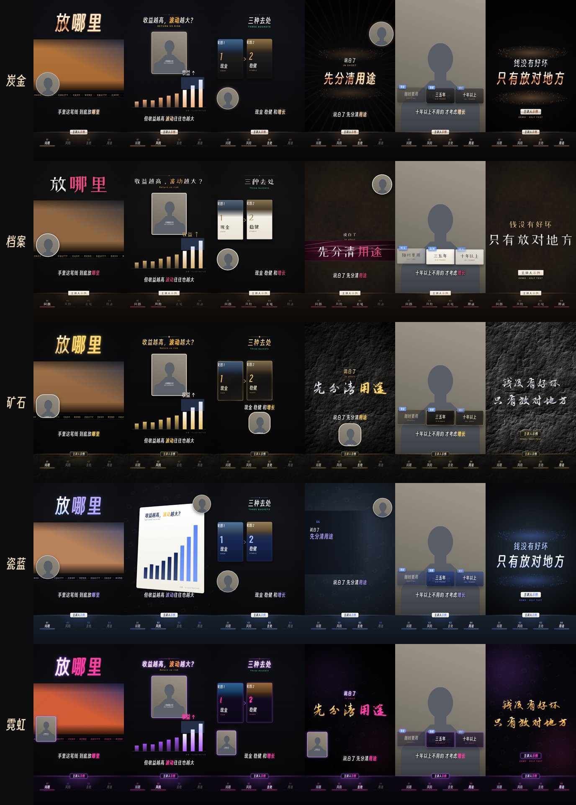

# FW-IFA 图解口播 · explainer-studio

把一条**真人对着镜头说话**的口播原片，做成财经知识类的「图解口播」竖版成片：人物讲述和全屏图解交替，配金属大字、玻璃卡、人物小窗、透视图表、持续缓动，交付的是 [OpenMotion](https://github.com/nexu-io/openmotion) 里**可以直接编辑的工程**和成片。

> **v1.1.0（2026-11-21）**：每一段按内容调展示细节和动态（重点词变色、情绪色调、节奏、入场方式、逐字展开），没写的按文字自动推断、并且克制使用；同版式同动作会被提醒。
>
> v1.0.0：一套统一骨架＋五套风格（炭金／档案／矿石／瓷蓝／霓虹），26 个版式；macOS／Windows 两套人物测量实现；一条命令安装；离线自检。



*上图是离线自检用占位人形生成的画面：同一段示例内容，五套风格各一行。真实使用时每支片会按内容挑不同的版式。*

## 它做什么

- **统一骨架**（五套风格都一样）：
  - 底部底座全片常驻，显示章节进度条；讲到新进展时换成「最新进展」卡。
  - 字幕位置统一，撞到小窗会自动让开。
  - 头顶标题按实测头顶摆放，不压人。
  - 小窗按人脸取景，脸完整。
  - 卡片、小窗、标签持续浮动，面板轻摆。
- **五套风格**：

  | 风格 | 适合 | 一句话 |
  |-|-|-|
  | 炭金 | 宏观、市场、上市估值 | 深炭底、金属大字、深色玻璃卡、粒子金句 |
  | 档案 | 行业史、机构、风险、保险 | 暖黑纸面、铬银衬线字、珐琅白卡、火漆印章、品红光带 |
  | 矿石 | 资源、地缘、产业链 | 石墨岩面、金框铭牌、圆角方窗居中、书法收尾 |
  | 瓷蓝 | 品牌、消费、商业模式 | 雾蓝底、白纸立体图表、滚动数字、全息环 |
  | 霓虹 | 科技、互联网、AI 产品 | 黑紫霓虹、斜切分屏、倾斜面积图、金色书法 |

- **统一，但不千篇一律**：选定风格只定外观，每一段还要按内容调：
  - 重点词换强调色，字幕里同一个词也变色；
  - 风险段偏红、增长段偏绿、补充说明偏蓝；
  - 反问和转折更有力，结论和金句逐字展开；
  - 标题和卡片的入场方式可以按段换。

  分镜表没写的按文字自动推断，但有节制：冲击式入场全片最多两次。
- **同风格也不重样**（整支片层面）：
  - 版式按内容挑（数字、清单、对比、人物、文件、金句……）；
  - 背景母题图标按题材选；
  - 镜像和倾角按片名变化；
  - 同一账号的片子会被提醒错开开场、收尾和母题。
- **人脸安全是硬规则**：先量人物（人脸框、头顶、身体边界），再按量出来的数摆元素。任何元素碰到头部，构建直接失败。
- **macOS／Windows 都能用**：
  - 人物测量在 macOS 上用系统 Vision；
  - Windows／Linux 上用 MediaPipe，兜底用 OpenCV；
  - 所有脚本都是 Python。

## 安装

**基础是 OpenMotion**（开源本地动效视频工作台，工程、预览、编辑器、导出都靠它）：https://github.com/nexu-io/openmotion 。本技能在 `@openmotion/app` 0.1.1 上测试通过，下面的安装脚本会帮你装好。

1. 装技能：

   ```bash
   npx skills add BruceWHY007/FW-IFA-explainer-studio -g --agent claude-code
   ```

   技能会装到 `~/.agents/skills/fw-ifa-explainer-studio`。用其他 Agent 时，把 `claude-code` 换成 `codex` 等。

2. 装基础 OpenMotion 和依赖（Windows 把 `python3` 换成 `py -3.11`）：

   ```bash
   cd ~/.agents/skills/fw-ifa-explainer-studio
   python3 scripts/setup.py --check     # 只检查，看缺什么
   python3 scripts/setup.py             # 安装：Node／ffmpeg 缺了会给出命令；Pillow、MediaPipe（Windows）、OpenMotion 自动装；最后自检
   ```

3. 离线自检（可选，几秒钟，不需要任何视频）：

   ```bash
   python3 scripts/selftest.py --snapshot
   ```

4. **发一段口播视频给你的 Agent 试做**：30–60 秒，手机竖拍、对着镜头说话就行，头顶最好留一点空。

需要提前装好的：Node 22.18+、ffmpeg、Python 3.9–3.12（Windows 用 MediaPipe 需要 3.9–3.12）。Chrome 有就用本机的，没有时 OpenMotion 会自己下载。

## 最短用法

把原片交给 Agent，说：

> 把这条口播做成图解口播。我是 XXX，这条讲 XXX，想要「讲钱」的感觉（或者直接说用炭金／档案／矿石／瓷蓝／霓虹）。

Agent 会按技能流程做：
1. 转写和校对；
2. 剪掉口误和停顿；
3. 处理人声和字幕；
4. 量人物；
5. 选风格、写分镜表；
6. 找可商用 B-roll；
7. 构建；
8. 检查和抽帧自查；
9. 存进 OpenMotion；
10. 导出。

交付成片、编辑器链接和制作说明。之后可以在 OpenMotion 的 Studio 里直接改字、调时间、换素材。

流程细节见 [`skills/FW-IFA-explainer-studio/SKILL.md`](skills/FW-IFA-explainer-studio/SKILL.md)，版式和分镜表写法在 `references/`。

## 状态

- macOS：整条流程实测通过，包括转写后的剪辑、人声、字幕、测量、构建、检查、存工程、导出和 14 项技术校验。
- Windows：按 OpenMotion 和各依赖的官方 Windows 支持写成；MediaPipe 测量在 macOS 上和系统 Vision 对比过（头顶差 1px），Windows 真机还没跑过。第一次在 Windows 上用，请留下 `setup.py --check` 的输出。

## 第三方资源与许可

- 代码：MIT（见 LICENSE）。
- 字体（随技能附带，许可证文件在字体旁边）：得意黑 Smiley Sans、Inter、Oswald、站酷小薇、志莽行书，均为 SIL Open Font License 1.1。
- 图标：Lucide，ISC License（`assets/icons/LUCIDE-LICENSE.txt`）。
- 底纹：程序生成（`scripts/gen_textures.py`）。
- OpenMotion（Apache-2.0）不随本仓库分发，由安装脚本从官方 npm 包安装。
- 音效、配乐不随仓库分发；`TUJIE_SFX_DIR` 可以指到你自己有授权的音效目录。
- 画面包装的方法参考了公开的财经知识类视频，只借版式和动效方法，不含其内容、品牌或素材。
